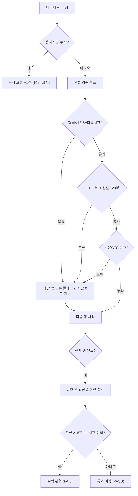

# 02. KPC 자격인증 서류 검증 시스템 기능 명세서 (PRD/FS)

- **버전**: v1.0.0
- **상태**: 승인 완료 (Approved)
- **작성일**: 2026-10-29
- **작성자**: 개발팀
- **검토자**: 프로젝트 관리자
- **상위 문서**: [00.문서인덱스.md](00.문서인덱스.md)
- **요구사항 매핑**: [01.요구사항정의서-SRS.md](01.요구사항정의서-SRS.md)

---

## 1. 기능 분류 및 추적성 매트릭스

| 기능 ID (FN) | 기능명 | 요구사항 ID (FR) | 관련 화면 (SCR) | 핵심 처리 모듈 |
| :--- | :--- | :--- | :--- | :--- |
| **FN-BASE-01** | 응시 기준 정보 관리 | FR-BASE-01 | SCR-MAIN | `BaselineManager` |
| **FN-BASE-02** | 스마트 엑셀 파싱 및 자동 슬롯 배분 | FR-BASE-02 | SCR-MAIN | `ExcelParser` |
| **FN-CLOG-01** | 코칭일지 헤더 및 필수 6개 열 누락 검증 | FR-CLOG-01 | SCR-DETAIL-CLOG | `CoachingLogValidator` |
| **FN-CLOG-02** | 코칭일지 날짜·시간 오름차순 정렬 검증 | FR-CLOG-02 | SCR-DETAIL-CLOG | `CoachingLogValidator` |
| **FN-CLOG-03** | 단일 세션 시간 및 일일 동일인 한도 검증 | FR-CLOG-03 | SCR-DETAIL-CLOG | `CoachingLogValidator` |
| **FN-CLOG-04** | 코칭형태 인원수 및 금지 수단 검증 | FR-CLOG-04 | SCR-DETAIL-CLOG | `CoachingLogValidator` |
| **FN-CLOG-05** | 받은 코치더코치 가중치 및 상한 절사 | FR-CLOG-05 | SCR-DETAIL-CLOG | `CoachingLogValidator` |
| **FN-CLOG-06** | 오류 행 시간 전액 차감 및 10건 초과 탈락 판정 | FR-CLOG-06 | SCR-DETAIL-CLOG | `CoachingLogValidator` |
| **FN-MENT-01** | 멘토코칭 KAC 이후 및 이수 기간(60/90일) 검증 | FR-MENT-01 | SCR-DETAIL-MENT | `MentorCoachingValidator` |
| **FN-MENT-02** | 멘토코칭 의무시간 및 60분 상한 절사 | FR-MENT-02 | SCR-DETAIL-MENT | `MentorCoachingValidator` |
| **FN-MENT-03** | 멘토코치 자격번호 및 자격 상태 유효성 검증 | FR-MENT-03 | SCR-DETAIL-MENT | `MentorCoachingValidator` |
| **FN-CCTC-01** | 1:1 코치더코치 선행자격 및 1:1 형태 검증 | FR-CCTC-01 | SCR-DETAIL-CCTC | `CoachTheCoachValidator` |
| **FN-CCTC-02** | 1:1 코치더코치 세션시간(30~60분) 및 의무시간 검증 | FR-CCTC-02 | SCR-DETAIL-CCTC | `CoachTheCoachValidator` |
| **FN-CROS-01** | 3종 서류 교차 중복 및 동시 수행 충돌 전수 검출 | FR-CROS-01 | SCR-DETAIL-CROS | `CrossTimelineChecker` |
| **FN-CROS-02** | 코칭 교육 시간 중 실습 배제 검증 | FR-CROS-02 | SCR-DETAIL-CROS | `CrossTimelineChecker` |
| **FN-DASH-01** | 종합 스코어보드 집계 및 위험도 표시 | FR-DASH-01 | SCR-DASH | `DashboardAggregator` |
| **FN-REPT-01** | 진단 리포트 인쇄 및 오류 행 수정 가이드 복사 | FR-REPT-01 | SCR-REPORT | `ReportGenerator` |

---

## 2. 세부 기능 명세

### 2.1 [FN-BASE-01] 응시 기준 정보 관리
- **입력값**:
  - `applicantName`: 응시자 성명 (String)
  - `examType`: 응시 트랙 (`STANDARD` 일반 / `PORTFOLIO` 포트폴리오)
  - `kacCertDate`: KAC 자격 취득일 (`YYYY-MM-DD`)
  - `coachingEduStartDate`: 코칭 교육 시작일 (`YYYY-MM-DD`)
  - `educationSchedules`: 코칭 교육 일정 목록 (Array of `{ date, startTime, endTime }`, 선택 입력)
- **처리 로직**:
  - 입력값 변경 시 즉시 메모리 상태 업데이트.
  - 날짜 형식 정규식(`^\d{4}-\d{2}-\d{2}$`) 유효성 검사.
  - 파일이 이미 업로드된 상태에서 기준 정보가 수정되면 전체 검증 파이프라인 자동 재실행.
- **예외 처리**: 필수 일자 미입력 시 검증 영역에 "기준 정보를 입력해 주세요" 플레이스홀더 표시.

---

### 2.2 [FN-BASE-02] 스마트 엑셀 파싱 및 자동 슬롯 배분
- **입력값**: 사용자 업로드 파일 1~3개 (`.xlsx`, `.xls`, `.csv`)
- **처리 로직**:
  1. `FileReader`를 통해 `readAsArrayBuffer`로 읽은 후 SheetJS `XLSX.read` 실행.
  2. 첫 번째 워크시트 탐색 및 식별 키워드 검사:
     - A1~A3 셀에 `인증_1_43` 또는 《코칭일지》 포함 시 -> `SLOT-COACHING-LOG`
     - A1~A3 셀에 `인증_1_47` 또는 《멘토코칭》 포함 시 -> `SLOT-MENTOR`
     - A1~A3 셀에 `인증_48` 또는 《1:1 코치더코치》 포함 시 -> `SLOT-COACH-THE-COACH`
  3. 시트 헤더 행(6행 전후) 탐색 후 데이터 행 추출.
  4. '예)'로 시작하는 예시행 및 '합계' 행 스킵, 실제 데이터 행만 정규화 객체 배열로 변환.
- **출력값**: `NormalizedSessionList` (서류 타입별 세션 배열)

---

### 2.3 [FN-CLOG-01 ~ 06] 코칭일지 검증 기능군

*(텍스트 대체 다이어그램: 데이터 행 파싱 후 응시자명 확인 -> 행별 형식, 시간범위, 코치더코치 규격 검증 -> 위반 시 해당 행 1건 오류 및 시간 100% 제외 -> 유효행 합산 및 상한 절사 -> 10건 초과 또는 시간 미달 시 탈락 위험 판정)*

- **핵심 계산 로직**:
  - `ErrorCount`: 오류가 발생한 고유 행 수의 합계 (응시자명 누락 시 +1건).
  - `ValidRows`: 오류 플래그가 없는 정상 행 집합.
  - `TotalPaidHours`: `SUM(ValidRows.paidMinutes)`
  - `CalculatedCTC`:
    - KAC 이전 세션 합계 중 최대 1,500분(25시간)까지만 인정.
    - KAC 이후 세션 합산 후 전체 최대 4,800분(80시간)까지만 인정.
  - `TotalValidHours`: `TotalPaidHours + TotalFreeHours + CalculatedCTC`
- **합격 기준**:
  - `ErrorCount <= 10`
  - `TotalValidHours >= 12,000분 (200시간)`
  - `TotalPaidHours >= 2,400분 (40시간)`
  - `UniqueClients >= 5명` (받은CTC 행 제외)

---

### 2.4 [FN-MENT-01 ~ 03] 멘토코칭 검증 기능군
- **기간 계산**:
  - 유효 세션(오류 없는 세션) 중 가장 이른 날짜 $D_{start}$와 가장 늦은 날짜 $D_{end}$ 산출.
  - $\Delta Day = \frac{D_{end} - D_{start}}{86400 \times 1000}$
  - 일반 응시: $\Delta Day \ge 60$, 포트폴리오 응시: $\Delta Day \ge 90$ 미충족 시 종합 '탈락 위험'.
- **세션 시간 상한 및 합산**:
  - 행별 인정 시간: $\min(\text{실제시간}, 60\text{분})$. (60분 초과 시 60분까지만 가산하고 안내 경고).
  - 일반 응시: 유효 세션 수 $\ge 5$회기 및 총 인정시간 $\ge 300$분.
  - 포트폴리오 응시: 총 인정시간 $\ge 600$분.
- **자격 검증**:
  - 코치명 열에 `/(KPC|KSC)\d+/` 정규식 미매칭 시 오류.
  - 코치인증자격 열이 '유효'가 아닐 경우 종합 '탈락 위험' 판정.

---

### 2.5 [FN-CCTC-01 ~ 02] 1:1 코치더코치 검증 기능군
- **세션 규격 검증**:
  - 형태가 '1:1'이 아닌 경우 미인정 오류.
  - 단일 세션 시간 $\notin [30, 60]$ 범위인 경우 미인정 오류.
  - 코치 자격이 '유효'가 아닌 경우 미인정 오류.
- **의무 시간 충족 검증**:
  - 일반 응시: 총 유효 시간 $\ge 300$분 (5시간).
  - 포트폴리오: 총 유효 시간 $\ge 480$분 (8시간).

---

### 2.6 [FN-CROS-01 ~ 02] 크로스 타임라인 중복 및 충돌 검출
- **타임라인 병합 알고리즘**:
  1. 3종 서류의 모든 세션을 타임스탬프 구간 $[S_i, E_i]$와 메타정보 `{docType, rowIdx, coachOrClient}`로 변환.
  2. 시간순 정렬 후 인접 및 전체 쌍 간의 교집합 구간 검사 ($S_i < E_j \land S_j < E_i$).
  3. 충돌 분류:
     - 두 세션의 일시가 동일하고 대상자명이 일치하는 경우: **상호 중복 기재 (Type 1)**
     - 두 세션의 대상자가 다르거나 역할이 모순(코치하면서 피코칭)되는 경우: **동시 수행 불가 충돌 (Type 2)**
     - 기본정보에 입력된 코칭 교육 시간과 겹치는 경우: **교육 중 실습 금지 위반 (Type 3)**
- **페널티 처리**:
  - 코칭일지 쪽 행은 행 오류(10건 집계)에 포함 및 시간 100% 제외.
  - 멘토코칭 / 1:1 코치더코치 쪽 행은 인정 시간에서 제외.

---

### 2.7 [FN-DASH-01, FN-REPT-01] 대시보드 및 리포트
- **대시보드 표시 상태**:
  - 종합 판정: `통과 예상` (초록 뱃지) 또는 `탈락 위험` (빨강 뱃지)
  - 4개 주요 수치 카드:
    1. 코칭일지 유효 시간 (`X시간 Y분 / 200h`) & 유료 시간 (`X시간 / 40h`)
    2. 코칭일지 오류 건수 (`N건 / 최대 10건`)
    3. 멘토코칭 충족도 (`X회기 Y분 / 5h, N일 / 60일`)
    4. 1:1 코치더코치 충족도 (`X시간 Y분 / 5h`)
- **수정 가이드 클립보드 복사**:
  - 검출된 모든 오류를 "서류명 | 엑셀 행 번호 | 오류 항목 | 권장 수정 조치" 형식의 마크다운 표로 생성하여 클립보드에 복사.

