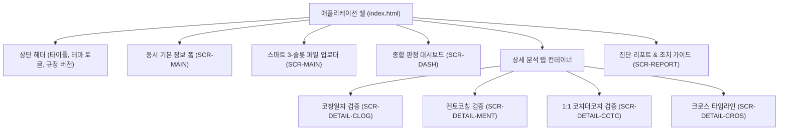

# 03. KPC 자격인증 서류 검증 시스템 정보 구조 설계서 (IA)

- **버전**: v1.0.0
- **상태**: 승인 완료 (Approved)
- **작성일**: 2026-10-29
- **작성자**: 개발팀
- **검토자**: 프로젝트 관리자
- **상위 문서**: [00.문서인덱스.md](00.문서인덱스.md)
- **기능 매핑**: [02.기능명세서-PRD-FS.md](02.기능명세서-PRD-FS.md)

---

## 1. 구조 설계 원칙 및 애플리케이션 쉘

본 시스템은 단일 HTML 파일(`index.html`)로 동작하는 로컬 Single Page Application입니다. 별도의 백엔드 라우팅 없이 브라우저 상의 단일 페이지 내에서 상태 전이와 탭 내비게이션을 통해 모든 정보를 구조화합니다.

*(텍스트 대체 다이어그램: 애플리케이션 쉘 하위에 상단 헤더, 기본정보 폼, 업로더, 종합 대시보드가 배치되고, 그 아래 4개 상세 탭(코칭일지, 멘토코칭, 1:1 CTC, 크로스 타임라인) 및 하단 리포트 출력 영역이 위치함)*

---

## 2. 화면 등록부 (Screen Registry)

| 화면 ID | 화면명 | UI 밀도 | 주요 기능 | 매핑 기능 ID (FN) | 사용자 역할 |
| :--- | :--- | :--- | :--- | :--- | :--- |
| **SCR-MAIN** | 메인 설정 및 업로드 | 보통 (Comfortable) | 응시정보 입력, 엑셀 3종 드래그앤드롭, 파일 상태 확인 | FN-BASE-01, FN-BASE-02 | 일반 사용자 |
| **SCR-DASH** | 종합 판정 대시보드 | 조밀 (Compact) | 최종 판정(통과/탈락), 4개 핵심 지표 카드 및 진행률 바 | FN-DASH-01 | 일반 사용자 |
| **SCR-DETAIL-CLOG** | 코칭일지 상세 분석 | 조밀 (Compact) | 행별 검증 테이블, 오류 태그, 시간 합산 요약, 10건 한도 | FN-CLOG-01, FN-CLOG-02, FN-CLOG-03, FN-CLOG-04, FN-CLOG-05, FN-CLOG-06 | 일반 사용자 |
| **SCR-DETAIL-MENT** | 멘토코칭 상세 분석 | 보통 (Comfortable) | 회기, 기간(60/90일), 60분 상한 절사, 자격 유효성 내역 | FN-MENT-01, FN-MENT-02, FN-MENT-03 | 일반 사용자 |
| **SCR-DETAIL-CCTC** | 1:1 코치더코치 상세 | 보통 (Comfortable) | 30~60분 세션 검증, KAC 이후 이수 확인, 의무시간 현황 | FN-CCTC-01, FN-CCTC-02 | 일반 사용자 |
| **SCR-DETAIL-CROS** | 크로스 타임라인 분석 | 조밀 (Compact) | 3개 서류 통합 시간대, 중복 기재 및 동시 진행 충돌 목록 | FN-CROS-01, FN-CROS-02 | 일반 사용자 |
| **SCR-REPORT** | 진단 리포트 및 출력 | 인쇄 최적화 | 인쇄용 종합 진단서, 엑셀 행별 수정 조치 가이드 복사 | FN-REPT-01 | 일반 사용자 |

---

## 3. 도메인 엔티티 명세 (Domain Entities)

모든 엔티티는 브라우저 자바스크립트 런타임 메모리에만 존재하며, 세션 종료나 새로고침 시 즉시 파기됩니다 (휘발성). 테마 설정값만 `localStorage`에 비식별 형태로 보관됩니다.

### 3.1 [ENT-BASELINE] 응시 기준 정보
- **속성**:
  - `applicantName`: 응시자 성명 (문자열, 민감도: 낮음)
  - `examType`: 응시 트랙 (`STANDARD` | `PORTFOLIO`)
  - `kacCertDate`: KAC 취득일 (`YYYY-MM-DD`)
  - `coachingEduStartDate`: 코칭 교육 시작일 (`YYYY-MM-DD`)
  - `educationSchedules`: 코칭 교육 일정 배열 `[{ date, startTime, endTime }]`
- **보유 주기**: 브라우저 탭 세션 메모리 (외부 전송 0건)

### 3.2 [ENT-SESSION] 정규화된 코칭 세션
- **속성**:
  - `id`: 세션 고유 식별자 (`String`)
  - `docType`: 서류 구분 (`CLOG` | `MENT` | `CCTC`)
  - `rowIndex`: 원본 엑셀 행 번호 (1-based integer)
  - `date`: 세션 날짜 (`YYYY-MM-DD`)
  - `startTime`: 시작 시간 (`HH:MM`)
  - `endTime`: 종료 시간 (`HH:MM`)
  - `startEpoch`: 시작 타임스탬프 (밀리초)
  - `endEpoch`: 종료 타임스탬프 (밀리초)
  - `durationMinutes`: 실제 진행 시간 (분)
  - `coachOrClient`: 고객명 또는 코치명 (`String`)
  - `coachCertNo`: 코치 자격번호 (`String`, 멘토/CTC의 경우)
  - `certStatus`: 코치 자격 상태 (`유효` 등)
  - `feeType`: 유료 / 무료 / 받은CTC (`PAID` | `FREE` | `CTC_RECEIVED`)
  - `recordedMinutes`: 엑셀 셀에 기재된 분 값
  - `coachingFormat`: 코칭 형태 문자열 (예: `1:1 비대면`)
  - `participantCount`: 파싱된 인원수 (`Integer`)
  - `errors`: 해당 행에서 적발된 위반 규칙 코드 목록 (`Array of String`)
  - `isValid`: 오류 여부 (`Boolean`, errors.length === 0)
  - `creditedMinutes`: 최종 유효 인정 시간 (분)

### 3.3 [ENT-RESULT] 최종 검증 판정 결과
- **속성**:
  - `overallStatus`: 종합 판정 (`PASS_EXPECTED` | `FAIL_RISK`)
  - `failReasons`: 탈락 위험 사유 요약 목록 (`Array of String`)
  - `clogSummary`: `{ totalMinutes, paidMinutes, ctcMinutes, errorCount, clientCount, isPassed }`
  - `mentSummary`: `{ totalMinutes, sessionCount, spanDays, isPassed }`
  - `cctcSummary`: `{ totalMinutes, isPassed }`
  - `crossConflicts`: 상호 충돌 세션 쌍 배열

---

## 4. 내부 모듈 인터페이스 카탈로그 (Module Interface Catalog)

본 시스템은 외부 HTTP API가 없으므로 내부 핵심 로직 함수 계약을 인터페이스(`IF-*`)로 정의합니다.

| 인터페이스 ID | 함수/메서드 시그니처 | 목적 및 역할 | 호출 모듈 |
| :--- | :--- | :--- | :--- |
| **IF-PARSE-01** | `parseWorkbook(arrayBuffer): RawSheets` | 엑셀 바이너리를 파싱하여 워크시트 객체 반환 | FileDropZone |
| **IF-PARSE-02** | `classifyAndNormalize(rawSheets): DocumentBundle` | 키워드 기반 서류 분류 및 공통 `ENT-SESSION` 배열 추출 | PipelineController |
| **IF-VAL-CLOG** | `validateCoachingLog(sessions, baseline): ClogResult` | 코칭일지 14개 규칙 검증, 10건 누적 체크, 시간 차감 | PipelineController |
| **IF-VAL-MENT** | `validateMentor(sessions, baseline): MentResult` | 멘토코칭 60/90일 기간, 60분 상한 절사, 자격 검증 | PipelineController |
| **IF-VAL-CCTC** | `validateCoachTheCoach(sessions, baseline): CctcResult` | 1:1 CTC 30~60분 규격, KAC 이후, 의무시간 검증 | PipelineController |
| **IF-VAL-CROSS** | `checkCrossTimeline(allSessions, eduList): ConflictResult` | 3종 서류 및 교육일정 간 겹침/동시수행 충돌 전수 검사 | PipelineController |
| **IF-REP-SCORE** | `aggregateScoreboard(clog, ment, cctc, cross): FinalResult` | 4대 영역 종합 판정 및 스코어보드 데이터 모델 생성 | ViewRenderer |
| **IF-REP-PRINT** | `generatePrintDocument(finalResult): void` | 브라우저 인쇄 팝업(`window.print()`) 트리거 및 스타일 제어 | ReportComponent |
